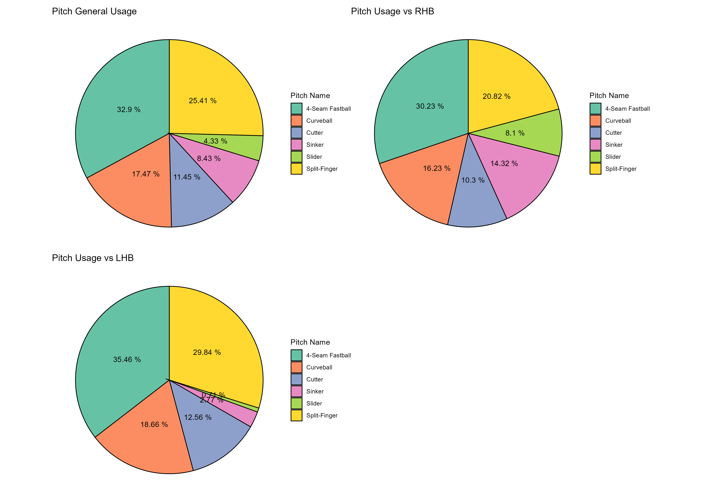
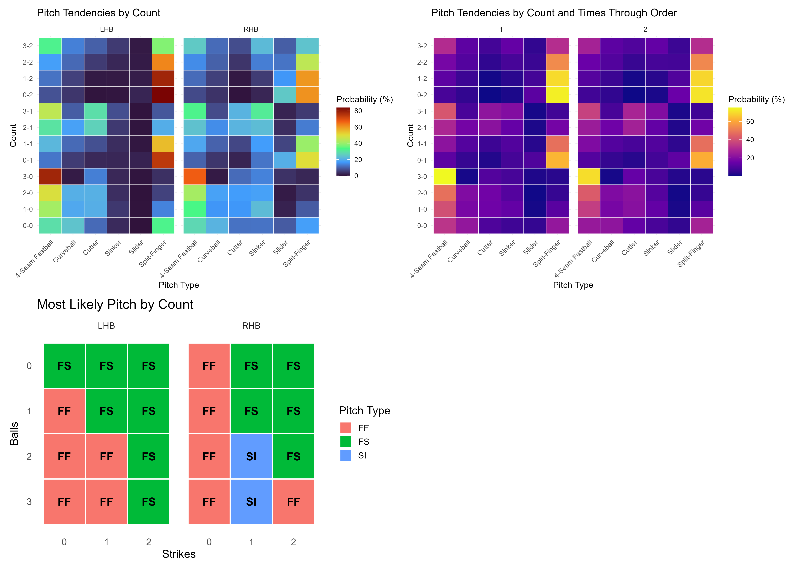
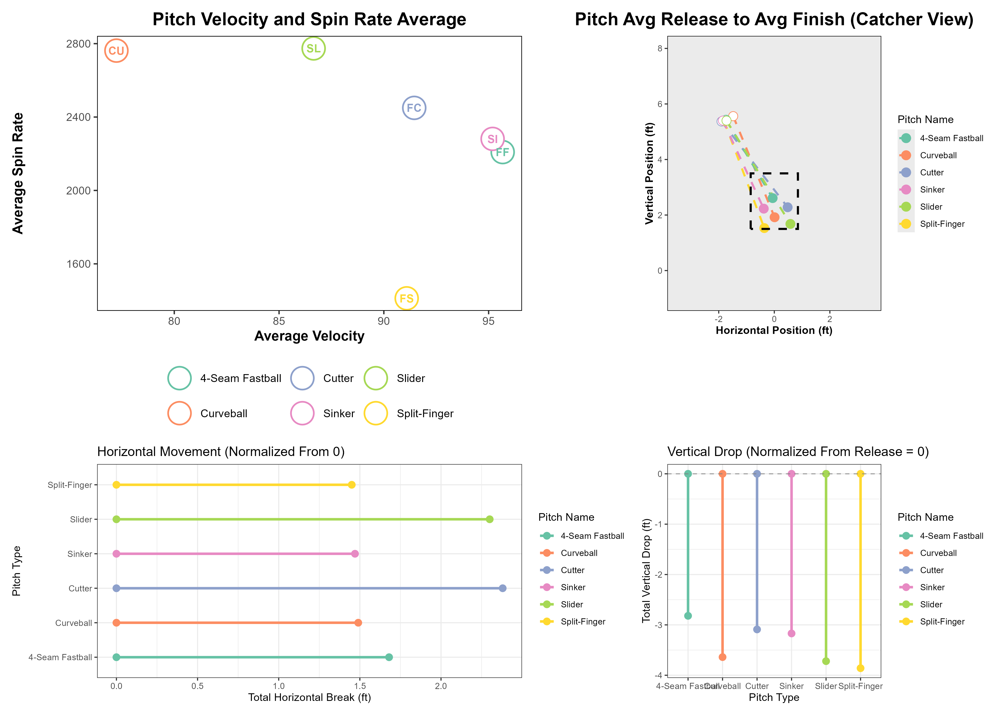
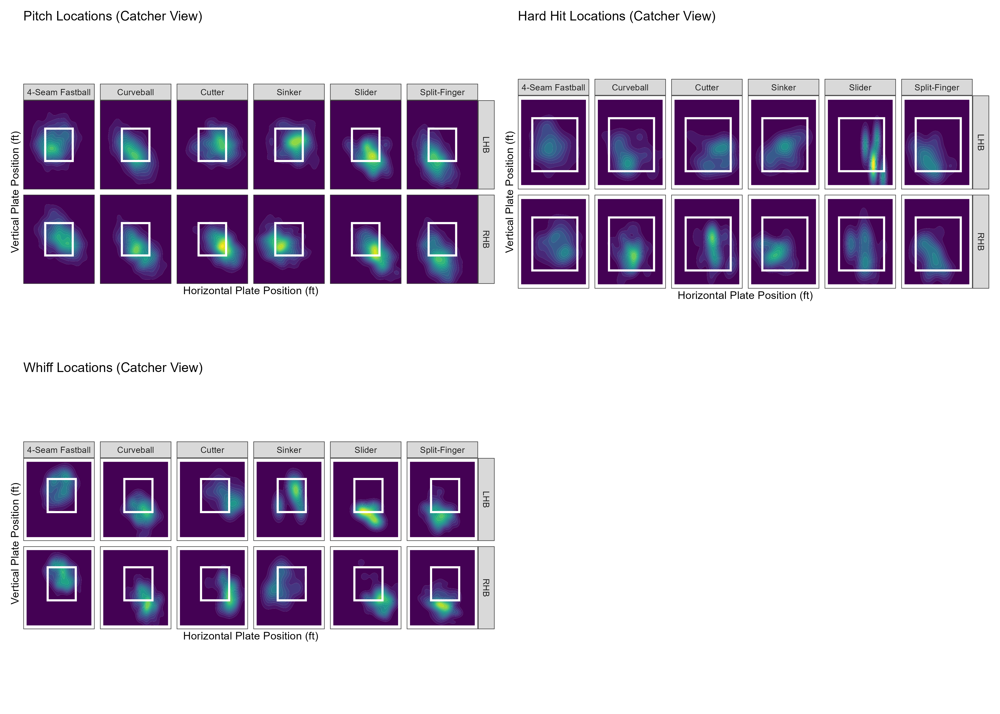

# End-to-End Automated Pitcher Scouting & Analytics Pipeline

An automated data engineering and analytics pipeline built in R that connects to a PostgreSQL database containing millions of rows of **Statcast data (2023–2026)**. The pipeline ingests raw pitch-by-pitch tracking data, executes parameterized analytical queries, and generates comprehensive, production-grade player evaluation reports.

*Note: An interactive web application allowing users to dynamically input any Pitcher ID to instantly render these analytics is currently in active development.*

---

## 📈 Featured Example: Automated Scouting Report (Pitcher ID: 808967)

To demonstrate the pipeline's capabilities without requiring a live database connection, the results for an example pitcher have been compiled below.

### 1. Pitch Usage & Tactical Tendencies
The pipeline isolates pitches with \(\ge\) 10% usage and segments them by **Left-Handed Batters (LHB) vs. Right-Handed Batters (RHB) splits**. It tracks how arsenal deployment changes dynamically based on:
* **Count-by-Count Tendencies** (e.g., ahead, behind, 2-strikes)
* **Times Through the Order (TTO)** effects on velocity and spin maintenance





### 2. Normalized Movement Profiles
To isolate pure aerodynamic break from varying physical release points, the pipeline normalizes the release coordinates to a baseline of `(0,0)`. This allows direct, side-by-side scale comparison of vertical drop and horizontal movement.



### 3. Spatial Run-Value & Damage Heatmaps
Using 2D kernel density estimations, the pipeline visualizes pitch locations at the plate to identify execution strengths and vulnerabilities:
* **Whiff Heatmaps:** High-density zones where the pitcher generates maximum swing-and-miss.
* **Hard-Hit Heatmaps:** Spatial locations resulting in \(\ge\) 95 mph exit velocity to diagnose mistake pitches.



---

## 🛠️ Data Infrastructure & Repository Architecture

The core philosophy of this project is clean, modular, and reusable code.

```text
├── data_extract_functions/
│   ├── extract_data_from_database.r  # Parameterized SQL connection & safe data ingestion
│   └── process_scouting_metrics.r    # Core algorithmic splits (LHB/RHB, counts, TTO)
├── output/
│   └── pitcher_808967/               # Automated pipeline artifact exports
│       ├── pitch_usage_table.csv     # Granular summary data
│       ├── pitch_visuals.png
│       └── ...
└── run_analysis.R                    # Wrapper script to execute full pipeline
```

### Key Technical Implementations
* **Tidy Data Manipulation:** Leverages `tidyverse` (`dplyr`, `tidyr`) to efficiently reshape tracking variables into structured analytical data frames.
* **Exportable Data Artifacts:** Automatically structures and outputs standalone high-definition `.png` visualization assets alongside underlying `.csv` performance datasets for cross-departmental sharing.

---

## 💾 Processed Data Downloads

For deep-dive reviews, the raw tabular outputs generated directly by this pipeline can be accessed here:
* [Download Pitch Usage & Split Data (CSV)](output/pitcher_808967/pitch_usage_table.csv)
* [Download Pitch Characteristics & Spin/Velo Metrics (CSV)](output/pitcher_808967/pitch_characteristics_table.csv)
* [Download Pitch Performance Summary Metrics (CSV)](output/pitcher_808967/pitch_performance_table.csv)
